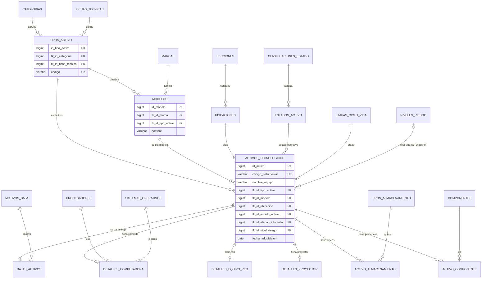
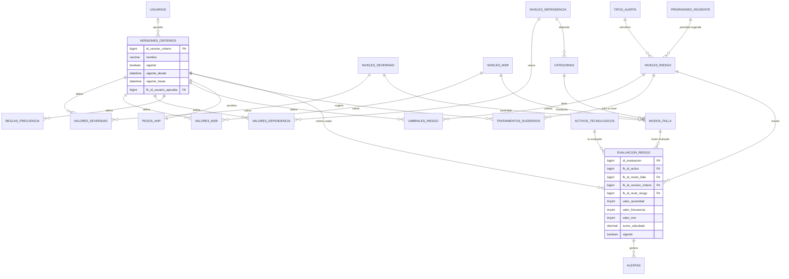
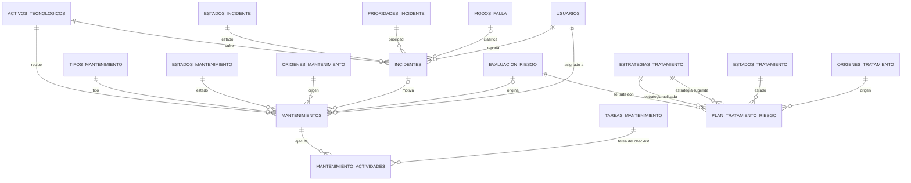
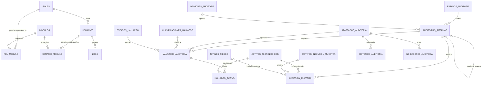

# Modelo de datos objetivo (3FN) — SIATEC · Fase 2

Propuesta de diseño. **No se ha modificado ninguna tabla ni código.** Insumo para el
MER (Figura 32) y el diccionario de datos (Anexo G).

## 1. Principios y convenciones

| Regla | Aplicación |
|---|---|
| Nombres | Tablas en plural y español; PK `id_<singular>`; FK `fk_id_<x>` (convención ya usada en el repo) |
| Catálogo estándar | `id_<x>`, `codigo` (estable, único, MAYÚSCULAS_SNAKE), `nombre`, `descripcion`, `orden`, `activo`, `created_at`, `updated_at` |
| Borrado | FK hacia catálogos con `ON DELETE RESTRICT`; un ítem en uso solo se desactiva (`activo = 0`) |
| `codigo` | Es lo único que el código PHP puede referenciar cuando es imprescindible (p. ej. `ESTADO_ACTIVO = 'DE_BAJA'`); nunca el `nombre` |
| Una tabla por dominio | No se usa el patrón `catalogos` + `catalogo_items`: casi todos los catálogos tienen FK reales y banderas propias |
| Vigencia | Los criterios del riesgo se versionan con **un solo encabezado** (`versiones_criterios`); una evaluación referencia esa versión |
| Snapshots | Se conservan los valores calculados que dan trazabilidad (ISO 31000 §6.7), documentados en la sección 5 |

### Qué cambia respecto al estado actual

El repo ya tiene 17 catálogos con **clave natural** (PK = texto) creados el 6-oct. La Fase 3 los
transforma: se agregan `id_<x>`, `codigo`, `activo` y timestamps, y las columnas de texto que hoy
apuntan a ellos pasan a `fk_id_<x>`. Equivalencia de nombres:

| Hoy (clave natural) | Objetivo |
|---|---|
| `estados_operativos` | `estados_activo` |
| `etapas_ciclo_vida`, `motivos_baja` | igual nombre, con `id` |
| `estados_incidente`, `prioridades_incidente`, `tipos_mantenimiento`, `estados_mantenimiento` | igual nombre, con `id` |
| `origen_mantenimiento` (ya con `id`) | `origenes_mantenimiento` (plural, + `codigo`/`orden`/`activo`) |
| `estrategias_tratamiento`, `estados_tratamiento`, `origenes_tratamiento`, `tipos_alerta` | igual nombre, con `id` |
| `niveles_dependencia`, `niveles_severidad`, `niveles_msr` | quedan como **concepto** (nivel); los números pasan a `valores_*` por versión |
| `niveles_frecuencia` | `reglas_frecuencia` (por versión) |
| `niveles_riesgo` | concepto + `umbrales_riesgo` (puntaje mínimo por versión) |
| `tratamientos_sugeridos` | igual nombre, por versión |

## 2. Diagramas MER

### 2.1 Activos y ubicación (ISO 55001 §7.5; ISO 55002 registro de activos)

### 2.2 Criterios y motor de riesgo (ISO 31000 §6.3.4, §6.4–6.5; FMEA AIAG-VDA)

### 2.3 Operación: incidentes, mantenimiento y tratamiento

### 2.4 Seguridad y auditoría interna

## 3. Diccionario de datos

Tipos MySQL. **PK**/**FK**/**UK**. `N` = admite NULL. Las columnas `created_at`/`updated_at`
(`TIMESTAMP N`) existen en todas las tablas y no se repiten.

### 3.1 Plantilla de catálogo (aplica a toda tabla marcada "cat.")

| Campo | Tipo | Nulo | Clave | Descripción |
|---|---|---|---|---|
| `id_<x>` | BIGINT UNSIGNED | No | PK | Identificador |
| `codigo` | VARCHAR(50) | No | UK | Código estable usado por el programa |
| `nombre` | VARCHAR(150) | No | UK | Etiqueta visible |
| `descripcion` | VARCHAR(255) | Sí |  | Texto de ayuda |
| `orden` | TINYINT UNSIGNED | No |  | Orden de presentación |
| `activo` | BOOLEAN | No |  | 0 = deshabilitado (no se puede borrar si está en uso) |

### 3.2 Catálogos y sus columnas adicionales

| Tabla (cat.) | PK | Columnas adicionales | Reemplaza |
|---|---|---|---|
| `clasificaciones_estado` | `id_clasificacion_estado` | — (Óptimo / Regular / Obsoleto) | `clasificarEstadoActivo()` con `str_contains` |
| `estados_activo` | `id_estado_activo` | `fk_id_clasificacion_estado` FK, `es_baja` BOOL | texto `estado_operativo` + literales `'De Baja'` |
| `etapas_ciclo_vida` | `id_etapa_ciclo_vida` | — | texto `etapa_ciclo_vida` |
| `motivos_baja` | `id_motivo_baja` | — | `MOTIVOS_BAJA` |
| `fichas_tecnicas` | `id_ficha_tecnica` | — (COMPUTADORA, RED, PROYECTOR, NINGUNA) | `tipoDetalle()` con `str_contains` |
| `tipos_activo` | `id_tipo_activo` | `fk_id_categoria` FK, `fk_id_ficha_tecnica` FK | tipo implícito en el nombre de categoría |
| `marcas` | `id_marca` | — | texto `marca` |
| `procesadores` | `id_procesador` | `frecuencia_ghz` DECIMAL(4,2) N; UK `(nombre, frecuencia_ghz)` | texto `procesador` |
| `sistemas_operativos` | `id_sistema_operativo` | — | texto `sistema_operativo` |
| `tipos_almacenamiento` | `id_tipo_almacenamiento` | — (SSD, HDD) | columnas `disco_solido_gb`/`disco_rigido_gb` |
| `componentes` | `id_componente` | — (Lector, Parlantes, Teclado y mouse, Monitor, Cámara web) | 5 booleanos |
| `secciones` | `id_seccion` | — | texto `ubicaciones.seccion` |
| `estados_incidente` | `id_estado_incidente` | `cierra_incidente` BOOL, `es_inicial` BOOL | texto + literal `'Reportado'` |
| `prioridades_incidente` | `id_prioridad_incidente` | `peso` TINYINT (1 = más urgente) | texto `prioridad` |
| `tipos_mantenimiento` | `id_tipo_mantenimiento` | — | texto + literales `'Preventivo'`/`'Correctivo'` |
| `estados_mantenimiento` | `id_estado_mantenimiento` | `es_abierto`, `es_finalizado`, `es_inicial` BOOL | texto + literales `'Programado'` |
| `origenes_mantenimiento` | `id_origen` (existente) | — | ya existe; se uniformiza |
| `tareas_mantenimiento` | `id_tarea_mantenimiento` | `numero` TINYINT UK | `Mantenimiento::TAREAS_CHECKLIST` |
| `estrategias_tratamiento` | `id_estrategia_tratamiento` | `genera_mantenimiento` BOOL | texto `estrategia` |
| `estados_tratamiento` | `id_estado_tratamiento` | `es_abierto`, `es_inicial`, `es_cierre` BOOL | texto + literales `'Pendiente'`/`'Completado'` |
| `origenes_tratamiento` | `id_origen_tratamiento` | — (automático, manual) | texto `origen` |
| `tipos_alerta` | `id_tipo_alerta` | `color_hex` CHAR(7) | texto `alertas.tipo_alerta` |
| `niveles_severidad` | `id_nivel_severidad` | — (muy_alta … insignificante) | `modos_falla.nivel_severidad` (texto) |
| `niveles_msr` | `id_nivel_msr` | — | `modos_falla.nivel_msr` (texto) |
| `niveles_dependencia` | `id_nivel_dependencia` | — (Alta, Media, Baja) | `categorias.nivel_dependencia` (texto) |
| `niveles_riesgo` | `id_nivel_riesgo` | `criticidad` VARCHAR(100) (nombre de columna que el código y los PDF ya usan), `fk_id_tipo_alerta` FK, `fk_id_prioridad_sugerida` FK, `requiere_tratamiento`, `notifica_alerta`, `incluir_en_muestra` BOOL | literales `'Crítico'`/`'Alto'` y `config('auditoria.muestra.incluir_siempre_niveles')` |
| `modulos` | `id_modulo` | — (dashboard, activos, incidentes, riesgos, mantenimiento, informes, usuarios) | 7 columnas `permiso_*` |
| `tipos_anotacion` | `id_tipo_anotacion` | — | `<option>` de `activos/show.blade.php:910-915` |
| `estados_auditoria` | `id_estado_auditoria` | `es_inicial`, `es_inmutable` BOOL | `AuditoriaInterna::ESTADOS` |
| `opiniones_auditoria` | `id_opinion_auditoria` | — | `AuditoriaInterna::OPINIONES` |
| `motivos_inclusion_muestra` | `id_motivo_inclusion` | — | `AuditoriaMuestra::MOTIVOS_INCLUSION` |
| `apartados_auditoria` | `id_apartado` | `numero` VARCHAR(10) UK (7.1–7.6), `reporte_referencia` VARCHAR(50) N | `HallazgoAuditoria::APARTADOS` y `$refsRa` |
| `clasificaciones_hallazgo` | `id_clasificacion_hallazgo` | `plazo_dias` SMALLINT N, `orden_gravedad` TINYINT | `CLASIFICACIONES` y `config('auditoria.plazos_dias')` |
| `estados_hallazgo` | `id_estado_hallazgo` | `es_cierre` BOOL | `HallazgoAuditoria::ESTADOS` |

### 3.3 Criterios del motor de riesgo (versionados)

| Tabla | Campo | Tipo | Nulo | Clave | Descripción |
|---|---|---|---|---|---|
| `versiones_criterios` | `id_version_criterio` | BIGINT | No | PK |  |
|  | `nombre` | VARCHAR(150) | No |  | p. ej. "Criterios tesis v1" |
|  | `vigente` | BOOLEAN | No |  | Solo una fila en 1 (índice único sobre columna generada) |
|  | `vigente_desde` | DATETIME | No |  | Inicio de vigencia |
|  | `vigente_hasta` | DATETIME | Sí |  | NULL mientras esté vigente |
|  | `fk_id_usuario_aprueba` | BIGINT | Sí | FK → `usuarios` | Quien aprobó el criterio (NULL en la carga inicial) |
|  | `motivo_cambio` | TEXT | Sí |  | ISO 31000 §6.7 |
| `valores_severidad` | `id_valor_severidad` | BIGINT | No | PK |  |
|  | `fk_id_version_criterio` | BIGINT | No | FK, UK(con nivel) |  |
|  | `fk_id_nivel_severidad` | BIGINT | No | FK |  |
|  | `valor` | TINYINT | No |  | 1–10 (Tabla 20) |
|  | `descripcion` | TEXT | No |  | Criterio textual |
| `valores_msr` | `id_valor_msr` | BIGINT | No | PK | Misma forma que `valores_severidad` (Tabla 22) |
| `valores_dependencia` | `id_valor_dependencia` | BIGINT | No | PK | Misma forma, sin `descripcion` (Tabla 8: 9/5/2) |
| `umbrales_riesgo` | `id_umbral_riesgo` | BIGINT | No | PK |  |
|  | `fk_id_version_criterio` | BIGINT | No | FK, UK(con nivel) |  |
|  | `fk_id_nivel_riesgo` | BIGINT | No | FK |  |
|  | `puntaje_minimo` | DECIMAL(4,2) | No |  | Tabla 29 (0 / 3 / 6 / 8) |
| `reglas_frecuencia` | `id_regla_frecuencia` | BIGINT | No | PK |  |
|  | `fk_id_version_criterio` | BIGINT | No | FK |  |
|  | `nombre` | VARCHAR(100) | No |  | Muy Alta / Moderada / Baja |
|  | `valor` | TINYINT | No |  | 9 / 6 / 2 |
|  | `desgaste_minimo` | DECIMAL(5,2) | Sí |  | % de desgaste |
|  | `incidentes_minimo` | TINYINT | Sí |  |  |
|  | `operador` | CHAR(3) | Sí |  | CHECK IN ('AND','OR'); NULL = regla por defecto |
|  | `orden` | TINYINT | No |  | Se evalúan en este orden |
| `pesos_ahp` | `id_config` | BIGINT | No | PK | (existente) |
|  | `fk_id_version_criterio` | BIGINT | No | FK, UK | Sustituye a `vigente` y `fecha_actualizacion` |
|  | `peso_severidad`, `peso_frecuencia`, `peso_msr` | DECIMAL(5,3) | No |  | Nivel 2; CHECK suma = 1 |
|  | `peso_riesgo_tecnico`, `peso_dependencia` | DECIMAL(5,3) | No |  | Nivel 1; CHECK suma = 1 |
| `tratamientos_sugeridos` | `id_tratamiento_sugerido` | BIGINT | No | PK |  |
|  | `fk_id_version_criterio` | BIGINT | No | FK, UK(con nivel) |  |
|  | `fk_id_nivel_riesgo` | BIGINT | No | FK |  |
|  | `fk_id_estrategia_tratamiento` | BIGINT | No | FK |  |
|  | `accion_preventiva` | TEXT | No |  |  |
|  | `dias_plazo` | SMALLINT | No |  |  |

### 3.4 Activos y ubicación

| Tabla | Campo | Tipo | Nulo | Clave | Descripción |
|---|---|---|---|---|---|
| `categorias` | `id_categoria` | BIGINT | No | PK |  |
|  | `nombre_categoria` | VARCHAR(255) | No | UK |  |
|  | `vida_util_meses` | INT | **No** |  | Sin default 60 en el código |
|  | `fk_id_nivel_dependencia` | BIGINT | No | FK | Sustituye al texto |
|  | `justificacion_dependencia` | TEXT | Sí |  |  |
|  | `es_red` | BOOLEAN | No |  | Sustituye a `config('auditoria.categorias_red')` |
| `ubicaciones` | `id_ubicacion` | BIGINT | No | PK |  |
|  | `fk_id_seccion` | BIGINT | No | FK |  |
|  | `codigo` | VARCHAR(50) | No | UK | Código corto normalizado |
|  | `nombre` | VARCHAR(150) | No | UK(con sección) | Aula, sala o CPD |
| `modelos` | `id_modelo` | BIGINT | No | PK |  |
|  | `fk_id_marca` | BIGINT | No | FK |  |
|  | `fk_id_tipo_activo` | BIGINT | No | FK | UK `(id_modelo, fk_id_tipo_activo)` para FK compuesta |
|  | `nombre` | VARCHAR(150) | No | UK(marca, tipo) |  |
| `modelo_atributo_valor` | `fk_id_modelo` | BIGINT | No | PK/FK | Especificaciones base heredables (opcional; ver D-4) |
|  | `atributo` | VARCHAR(50) | No | PK | Nombre de la columna técnica |
|  | `valor` | VARCHAR(100) | No |  |  |
| `activos_tecnologicos` | `id_activo` | BIGINT | No | PK |  |
|  | `codigo_patrimonial` | VARCHAR(255) | No | UK | Código institucional |
|  | `origen_externo` | VARCHAR(255) | Sí | UK | Clave de importación |
|  | `nombre_equipo` | VARCHAR(255) | No | IDX | No único (ver D-5) |
|  | `fk_id_tipo_activo` | BIGINT | No | FK | De aquí se deriva la categoría |
|  | `fk_id_modelo` | BIGINT | Sí | FK | FK compuesta `(fk_id_modelo, fk_id_tipo_activo)` |
|  | `fk_id_ubicacion` | BIGINT | No | FK |  |
|  | `fk_id_estado_activo` | BIGINT | No | FK |  |
|  | `fk_id_etapa_ciclo_vida` | BIGINT | No | FK |  |
|  | `fk_id_nivel_riesgo` | BIGINT | Sí | FK | **Snapshot** del motor (ver §5) |
|  | `fecha_adquisicion` | DATE | Sí |  | Precisión real = año |
|  | `observaciones` | TEXT | Sí |  | Solo notas libres; atributos migrados a su tabla |
| `bajas_activos` | `fk_id_activo` | BIGINT | No | PK/FK | 1:0..1 |
|  | `fecha_baja` | DATE | **Sí** |  | Hay bajas históricas sin fecha: no se inventa. Se exige al registrar nuevas bajas (validación de aplicación) |
|  | `fk_id_motivo_baja` | BIGINT | No | FK |  |
|  | `fk_id_estado_previo` | BIGINT | Sí | FK → `estados_activo` | Estado antes de la baja |
|  | `fk_id_usuario_baja` | BIGINT | Sí | FK |  |
| `detalles_computadora` | `fk_id_activo` | BIGINT | No | PK/FK |  |
|  | `fk_id_procesador` | BIGINT | Sí | FK |  |
|  | `fk_id_sistema_operativo` | BIGINT | Sí | FK |  |
|  | `ram_gb` | SMALLINT | Sí |  | Medida numérica: no necesita catálogo |
| `detalles_equipo_red` | `fk_id_activo` | BIGINT | No | PK/FK |  |
|  | `direccion_ip` | VARCHAR(45) | Sí | UK |  |
|  | `version_firmware` | VARCHAR(100) | Sí |  |  |
| `detalles_proyector` | `fk_id_activo` | BIGINT | No | PK/FK |  |
|  | `tipo_cable` | VARCHAR(100) | Sí |  |  |
|  | `calidad_imagen` | TINYINT | Sí |  |  |
| `activo_almacenamiento` | `id_activo_almacenamiento` | BIGINT | No | PK |  |
|  | `fk_id_activo` | BIGINT | No | FK |  |
|  | `fk_id_tipo_almacenamiento` | BIGINT | No | FK |  |
|  | `capacidad_gb` | INT | No |  |  |
| `activo_componente` | `fk_id_activo` | BIGINT | No | PK/FK |  |
|  | `fk_id_componente` | BIGINT | No | PK/FK |  |

### 3.5 Riesgo, incidentes, mantenimiento y tratamiento

| Tabla | Campo | Tipo | Nulo | Clave | Descripción |
|---|---|---|---|---|---|
| `modos_falla` | `id_modo_falla` | BIGINT | No | PK |  |
|  | `fk_id_categoria` | BIGINT | No | FK |  |
|  | `nombre_modo_falla` | VARCHAR(255) | No | UK(categoría) |  |
|  | `fk_id_nivel_severidad` | BIGINT | No | FK | Sustituye a `nivel_severidad` + `valor_severidad_base` |
|  | `fk_id_nivel_msr` | BIGINT | No | FK | Sustituye a `nivel_msr` + `valor_msr_base` |
|  | `justificacion_severidad`, `justificacion_msr`, `indicador_seguimiento` | TEXT | Sí |  |  |
| `evaluacion_riesgo` | `fk_id_version_criterio` | BIGINT | No | FK | **Criterio con el que se calculó** |
|  | `fk_id_nivel_riesgo` | BIGINT | No | FK | Sustituye al texto |
|  | `valor_severidad`, `valor_frecuencia`, `valor_msr` | TINYINT | No |  | Snapshot de entrada del cálculo |
|  | `score_calculado` | DECIMAL(5,2) | No |  | Snapshot de salida |
|  | `vigente`, `conteo_generico` | BOOLEAN | No |  |  |
| `alertas` | `fk_id_evaluacion` | BIGINT | No | FK |  |
|  | `notificacion_enviada` | BOOLEAN | No |  | El tipo/color se **deriva** de evaluación → nivel → `tipos_alerta`; se elimina `tipo_alerta` |
| `plan_tratamiento_riesgo` | `fk_id_estrategia_tratamiento` | BIGINT | No | FK |  |
|  | `fk_id_estrategia_sugerida` | BIGINT | Sí | FK | Snapshot inmutable de la sugerencia |
|  | `fk_id_estado_tratamiento` | BIGINT | No | FK |  |
|  | `fk_id_origen_tratamiento` | BIGINT | No | FK |  |
|  | `accion_preventiva`, `accion_sugerida`, `indicador_seguimiento`, `observacion_cierre` | TEXT | Sí |  | Texto de trabajo; los "sugeridos" son snapshot |
| `incidentes` | `fk_id_estado_incidente` | BIGINT | No | FK |  |
|  | `fk_id_prioridad_incidente` | BIGINT | No | FK |  |
|  | `fecha_incidente`, `fecha_cierre` | DATETIME | No / Sí |  | Hechos del evento |
| `mantenimientos` | `fk_id_tipo_mantenimiento` | BIGINT | No | FK |  |
|  | `fk_id_estado_mantenimiento` | BIGINT | No | FK |  |
|  | `fk_id_origen` | BIGINT | No | FK |  |
| `mantenimiento_actividades` | `fk_id_tarea_mantenimiento` | BIGINT | No | FK | Sustituye a `tarea` (texto) y `numero_tarea` |

### 3.6 Seguridad, bitácora y auditoría

| Tabla | Campo | Tipo | Nulo | Clave | Descripción |
|---|---|---|---|---|---|
| `roles` | `codigo` | VARCHAR(50) | No | UK | ADMIN / SOPORTE / DIRECTOR; sustituye a `config/roles.php` |
| `rol_modulo` | `fk_id_rol` | BIGINT | No | PK/FK | Permisos por defecto del rol (sustituye `permisosDefaultPorRol`) |
|  | `fk_id_modulo` | BIGINT | No | PK/FK |  |
| `usuario_modulo` | `fk_id_usuario` | BIGINT | No | PK/FK | Permiso individual (sustituye 7 columnas `permiso_*`) |
|  | `fk_id_modulo` | BIGINT | No | PK/FK |  |
|  | `habilitado` | BOOLEAN | No |  |  |
| `logs` | (sin cambios de estructura) | | | | `tabla_afectada`/`registro_id` son referencia polimórfica de bitácora de solo-agregar |
| `parametros_sistema` | `id_parametro` | BIGINT | No | PK |  |
|  | `clave` | VARCHAR(100) | No | UK |  |
|  | `valor` | VARCHAR(255) | No |  |  |
|  | `tipo_dato` | VARCHAR(20) | No |  | entero / decimal / texto |
|  | `unidad` | VARCHAR(30) | Sí |  | meses, días, % |
|  | `descripcion` | VARCHAR(255) | Sí |  |  |
| `criterios_auditoria` | `id_criterio_auditoria` | BIGINT | No | PK |  |
|  | `fk_id_apartado` | BIGINT | No | FK |  |
|  | `texto` | VARCHAR(255) | No |  | p. ej. "ISO 55001:2014 7.6" |
|  | `orden`, `activo` | | | | |
| `indicadores_auditoria` | `id_indicador` | BIGINT | No | PK |  |
|  | `codigo` | VARCHAR(50) | No | UK | `exactitud_inventario`, `tmr_incidentes_dias`… |
|  | `fk_id_apartado` | BIGINT | No | FK |  |
|  | `operador` | CHAR(2) | Sí |  | CHECK IN ('>=','<='); NULL si es informativo |
|  | `meta_valor` | DECIMAL(6,2) | Sí |  |  |
|  | `es_informativo` | BOOLEAN | No |  |  |
| `auditorias_internas` | `fk_id_estado_auditoria` | BIGINT | No | FK |  |
|  | `fk_id_opinion_auditoria` | BIGINT | Sí | FK |  |
|  | `snapshot_indicadores` | JSON | Sí |  | **Snapshot inmutable** al aprobar |
| `auditoria_muestra` | `fk_id_motivo_inclusion` | BIGINT | No | FK |  |
|  | `fk_id_nivel_riesgo` | BIGINT | Sí | FK | Nivel al muestrear; NULL = sin evaluar |
| `hallazgos_auditoria` | `fk_id_apartado` | BIGINT | No | FK |  |
|  | `fk_id_clasificacion` | BIGINT | No | FK |  |
|  | `fk_id_clasificacion_sugerida` | BIGINT | Sí | FK |  |
|  | `fk_id_estado_hallazgo` | BIGINT | No | FK |  |

## 4. Trazabilidad: lo que hoy está "oculto" → destino

| Hallazgo Fase 1 | Destino |
|---|---|
| #1 pesos por defecto `?? 0.648…` | `pesos_ahp` por versión; sin versión vigente → excepción |
| #2 `return 2`, `#94a3b8` | `reglas_frecuencia.es_por_defecto`; color obligatorio en `tipos_alerta` |
| #3–#5 60/12 meses, ≤ 12, 3 y 7 días | `categorias.vida_util_meses NOT NULL` + `parametros_sistema` |
| #6–#7 estados y niveles por literal | banderas (`es_inicial`, `es_cierre`, `es_baja`, `incluir_en_muestra`) |
| #8 `clasificarEstadoActivo()` | `clasificaciones_estado` + `estados_activo.fk_id_clasificacion_estado` |
| #9 `tipoDetalle()` / `CAMPOS_DETALLE` | `tipos_activo.fk_id_ficha_tecnica` |
| #10 matriz de permisos + `config/roles.php` | `modulos`, `rol_modulo`, `usuario_modulo`, `roles.codigo` |
| #11 `config/auditoria.php` | `parametros_sistema`, `indicadores_auditoria`, `criterios_auditoria`, `clasificaciones_hallazgo.plazo_dias`, `categorias.es_red` |
| #12 constantes de auditoría | 6 catálogos de auditoría |
| #13 `TAREAS_CHECKLIST` | `tareas_mantenimiento` |
| #14–#16 colores / `<option>` / SQL crudo | `color_hex` en catálogos relevantes; `tipos_anotacion`; join a `tipos_alerta` |

## 5. Snapshots que se conservan (documentados)

| Campo | Por qué se guarda aunque sea derivable |
|---|---|
| `evaluacion_riesgo.valor_*`, `score_calculado`, `fk_id_nivel_riesgo` | Registro auditable del resultado (ISO 31000 §6.7). Ahora reproducible por `fk_id_version_criterio` |
| `activos_tecnologicos.fk_id_nivel_riesgo` | La regla (≥ 4 evaluaciones vigentes → promedio) no es una consulta trivial y se usa en ~68 puntos del código |
| `plan_tratamiento_riesgo.*_sugerida`, `indicador_seguimiento` | Inmutables por diseño: distinguen lo sugerido de lo aplicado |
| `auditorias_internas.snapshot_indicadores`, `auditoria_muestra.fk_id_nivel_riesgo` | El informe aprobado no debe cambiar si cambian los datos |

## 6. Decisiones que requieren tu aprobación

| ID | Decisión | Recomendación | Impacto |
|---|---|---|---|
| D-1 | Catálogos con `id` + `codigo` en vez de clave natural | **Sí** (ya aceptado) | Reescribe las 18 FK de texto y las ~60 consultas con literales |
| D-2 | Quitar `activos.fk_id_categoria` (la categoría se deriva de `tipo → categoría`) | **Sí**, para 3FN pura. Alternativa: conservarla con FK compuesta `(fk_id_tipo_activo, fk_id_categoria)` | 74 referencias a `fk_id_categoria` en el código (parte son de `modos_falla`, que no cambia) |
| D-3 | Un único `versiones_criterios` para todo el modelo FMEA | **Sí** | Una sola FK reproduce escalas, umbrales y pesos de una evaluación |
| D-4 | Fichas técnicas con tablas tipadas, **sin** EAV (`atributos_tipo`) | **Sí**: el conjunto es pequeño y fijo (~14 atributos, 3 fichas), conserva `UNIQUE`, tipos numéricos e índices y no rompe `Sheets` de exportación. `modelo_atributo_valor` queda opcional | Nuevos atributos = migración (aceptable) |
| D-5 | `nombre_equipo` **sin** `UNIQUE` | **Sí**: hay 37 grupos repetidos legítimos (`lab-exao1` ×15). Solo `codigo_patrimonial` y `direccion_ip` son únicos | — |
| D-6 | Datos de baja a `bajas_activos` (1:0..1) | **Sí**: evita 4 columnas nulas salvo en `De Baja` | Toca `InformesController::activosDeBaja` y `ActivoTecnologicoController::update` |
| D-7 | Eliminar `modos_falla.valor_*_base` y los defaults `?? 5` / `?? 4` | **Sí**, **condicionado** a la verificación de datos (R-1) | Ver riesgo R-1 |
| D-8 | `roles.codigo` reemplaza los IDs de `config/roles.php` | **Sí** | `isAdmin()`/`isSoporte()`/`isDirector()` consultan por código |

## 7. Riesgos del diseño

| ID | Riesgo | Mitigación |
|---|---|---|
| R-1 | Hoy un modo con `valor_*_base` nulo o desactualizado usa S=5 / MSR=4. Al derivar el valor del nivel, el score **podría cambiar** | Antes de migrar (Fase 3) correr una consulta de discrepancias; los casos se resuelven asignando el nivel que reproduce el valor usado. Requiere MySQL activo |
| R-2 | Reescribir FK de texto a `id` en tablas con histórico | Columna nueva → poblar → validar → recién entonces eliminar la vieja, en migración separada |
| R-3 | FK compuesta `(fk_id_modelo, fk_id_tipo_activo)` rechaza activos con modelo de otro tipo | Es el comportamiento buscado; el importador reporta esas filas en el log de rechazos |
| R-4 | Mover `str_contains` a `fichas_tecnicas` puede reclasificar categorías (hoy `Impresoras` cae en "red") | Mapa explícito por categoría revisado contigo antes de la migración |
| R-5 | Derivar categoría desde el tipo exige tocar muchas consultas | `categoria()` como relación `hasOneThrough` + scope `deCategoria()`; el cambio se hace en Fase 4 con la prueba de equivalencia como red de seguridad |

## 8. Estado de implementación (Fase 3)

| Entregable | Ubicación | Observación |
|---|---|---|
| 8 migraciones de **expansión** | `database/migrations/2026_10_12_1000*` | Se ejecutan con `php artisan migrate`. Cada una expone `poblar()` idempotente |
| 4 migraciones de **contracción** | `database/contraccion/` | **No** corren con `migrate`. Solo con `php artisan migrate --path=database/contraccion`, después de la Fase 4. Verifican antes de borrar y abortan si falta una FK |
| Sincronización | `php artisan normalizacion:sincronizar` | Re-ejecuta las `poblar()`; es el paso previo a la contracción |
| Importador Excel | `php artisan inventario:importar <archivo> [--simular]` | Por encabezados; log CSV de filas rechazadas en `storage/logs` |
| Seeders | trait `SincronizaNormalizacion` | Completa las FK al terminar cada seeder de datos (andamiaje de transición) |
| Pruebas | `NormalizacionBaseDatosTest`, `ImportarInventarioTest` | Población, idempotencia, aborto de contracción, ida y vuelta |

Decisiones tomadas durante la implementación:

- **Marcas y modelos vacíos**: el modelo exige marca y modelo, así que el texto vacío se representa con `Sin marca` / `(sin modelo)` (constantes `N::SIN_MARCA`, `N::SIN_MODELO`); al revertir vuelven a `NULL`.
- **`Sin evaluar`** en `auditoria_muestra` se representa con `fk_id_nivel_riesgo` nula (no es un nivel de riesgo).
- **Modos de falla sin nivel textual** pero con `valor_*_base`: el nivel se deduce de la escala vigente (`valor` igual), de modo que el motor da el mismo puntaje. Los que no tienen ni nivel ni valor base bloquean la contracción (R-1) hasta que se clasifiquen.
- **`alertas.tipo_alerta`** se elimina solo si coincide, alerta por alerta, con el derivado de `evaluación → nivel → tipo`.
- **`ubicaciones`**: las filas que solo diferían en mayúsculas/espacios se fusionan reasignando sus activos.
- **Dirección IP**: `UNIQUE` se agrega solo si no hay repetidas; si las hay, queda registrado en el log y se agrega al depurarlas.
